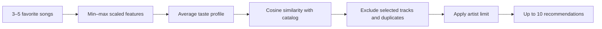

# SongMatch Recommendation Lab

**Can musical features recommend songs people enjoy more than genre matching or random selection?**

SongMatch Recommendation Lab is an interactive music discovery and evaluation app built with Python and Streamlit. Choose songs you like, explore recommendations, and compare three methods through a blind listening experiment.

The project extends the ideas behind SongMatch into a separate research prototype. Its purpose is to test the recommendation approach before considering integration into the mobile app.

**2,000 songs · 3 recommendation methods · 42 passing local tests · Black-and-purple interface**

[Getting started](#getting-started) · [How recommendations work](#how-recommendations-work) · [Data](#data-and-attribution) · [Evaluation](#evaluation-and-current-results) · [Architecture](#project-structure) · [Publishing](docs/PUBLISHING.md)

## Project status

The recommendation engine, three-page interface, anonymous feedback storage, results dashboard, and automated tests are implemented.

| Area | Status |
|---|---|
| Song catalog | 500 popular tracks + 1,500 independent tracks |
| Recommendation engine | Random, genre, and musical-feature methods implemented |
| Experiment workflow | Blind, shuffled recommendations with one rating per unique song |
| Local verification | 42 tests passed on Python 3.14.3 |
| GitHub Actions | Configured for pushes and pull requests; first remote run pending |
| Volunteer evaluation | Pending; no measured winning method |
| Public deployment and screenshots | Pending |

This repository contains a working research prototype. Recommendation quality still needs to be evaluated with real listeners. The [experiment report](reports/experiment_report.md) separates the study protocol from actual findings.

## Why this project exists

Genre labels are a useful starting point for music discovery, but songs in the same genre can differ substantially in mood, intensity, tempo, and acoustic character.

This lab asks whether those measurable musical characteristics can produce better recommendations. Two simple baselines provide context: random selection tests whether the method improves on chance, and genre matching tests whether the extra complexity adds value beyond a familiar category.

The project demonstrates:

- Content-based recommendation with numerical features.
- Dataset inspection, cleaning, attribution, and reproducible preprocessing.
- Experiment design with shared constraints, blinded presentation, and paired comparisons.
- Transactional feedback storage and evaluation with explicit metric denominators.
- A complete Streamlit workflow with behavioral tests and continuous integration.

## What you can do

### Discover

Search songs, artists, or genres and choose **3–5 favorites**. Request ten recommendations from any of the three methods, read short explanations, and inspect a chart comparing your musical profile with a recommended song.

The default **Popular hits** library contains 500 recognizable tracks from 265 artists, including:

| Artist | Example track |
|---|---|
| Taylor Swift | Shake It Off |
| Billie Eilish | bad guy |
| Ed Sheeran | Shape of You |
| Eminem | Without Me |
| Adele | Someone Like You |
| Queen | Bohemian Rhapsody — 2011 Mix |

Select **Full library** in the sidebar to include 1,500 independent Free Music Archive tracks, for 2,000 songs total.

### Compare methods

Choose favorites and start an anonymous listening session. All three methods use the same inputs, library, random seed, and artist limit.

Their results are merged and shuffled without method labels, ranks, explanations, or scores. A song recommended by several methods appears only once. For each song, give:

- **Like**, **Dislike**, or **Not sure / couldn’t assess**.
- Whether you already knew the song.
- Confirmation that you listened before assessing an unfamiliar song.

Method labels are revealed after submission. The app stores the same song rating against every method that recommended it.

### Results

Explore completed sessions, positive-rating rates, Precision@10 where applicable, unassessed counts, artist diversity, unfamiliar songs liked, and recommendation generation time.

Paired session rows and participant summaries help show whether the results differ between people. Metric summaries can be downloaded as CSV files.

## Technology

| Tool | Role |
|---|---|
| Python | Recommendation, data, storage, and evaluation logic |
| Streamlit | Multipage web interface |
| pandas and NumPy | Catalog preparation and feature processing |
| scikit-learn | Min–max scaling and cosine similarity |
| Plotly | Profile comparisons and experiment charts |
| CSV | Fixed, versioned song catalog |
| SQLite | Anonymous sessions, recommendations, and ratings |
| pytest and Streamlit AppTest | Engine, storage, metrics, and workflow checks |
| GitHub Actions | Automated checks on push and pull request |
| Docker Compose | Optional deployment with persistent database storage |

The interface uses SongMatch's black-and-purple palette. No accounts, payments, chat, or Spotify account integration are included.

## Getting started

### Requirements

- Python **3.12–3.14**. Local verification used Python 3.14.3.
- Internet access to install dependencies and use external listening links or FMA excerpts.
- A terminal opened in the project directory.

The cleaned catalog is included, so running the app does not require a dataset download or API key.

### Windows — PowerShell

```powershell
python -m venv .venv
.\.venv\Scripts\python.exe -m pip install -r requirements.txt
.\.venv\Scripts\python.exe -m streamlit run app.py
```

### macOS / Linux

```bash
python3 -m venv .venv
.venv/bin/python -m pip install -r requirements.txt
.venv/bin/python -m streamlit run app.py
```

Open **http://localhost:8501** in your browser. This is the address of your locally running app, not a hosted demo.

The commands below assume your virtual environment is activated, or that you replace `python` with its interpreter path. An exact dependency snapshot is also provided in [requirements-lock.txt](requirements-lock.txt).

### Run the engine without the interface

```bash
python -m scripts.recommend --songs popular:593 popular:787 popular:688 --seed 42
python -m scripts.recommend --library all
```

The CLI prints selected IDs, dataset and algorithm versions, seed, ranked results, scores where applicable, fallback flags, warnings, and timings.

## How recommendations work

Every method excludes selected songs and duplicate recordings. Each recommendation list allows at most **two tracks per artist**. When the eligible catalog cannot fill ten places under those constraints, the engine returns fewer results with a warning.

| Method | Approach |
|---|---|
| Random baseline | Seeded random permutation of eligible tracks, filtered by the artist limit |
| Genre baseline | Seeded sampling among the selected songs' broad genres, followed by clearly recorded out-of-genre fillers if needed |
| Musical-feature similarity | Compare the average selected-song feature vector with eligible tracks using cosine similarity |

### Feature similarity

The five numerical features are:

| Feature | Meaning |
|---|---|
| Tempo | Estimated musical speed in beats per minute |
| Energy | Estimated perceptual intensity and activity |
| Danceability | Estimated suitability for dancing |
| Valence | Estimated musical positivity |
| Acousticness | Estimated acoustic character or confidence |



Scaling is fitted across the chosen library. Each feature has equal weight, and the selected scaled vectors are averaged into one profile. Eligible songs are sorted by similarity, with stable song-ID ordering for ties.

Explanations use actual feature differences. They name the two closest dimensions and describe them as similar only when both differences are within 0.15 on the scaled range. A cosine score is a geometric similarity measure, **not a probability that someone will like a song**.

Zero-length profiles produce finite zero-score ties and a warning. Missing or invalid numerical features follow the cleaning policy rather than being invented.

The development seed is **42**. Artist-cap filtering changes the final random-sampling distribution, so the random baseline is not uniform over every possible valid ten-song list.

## Data and attribution

### Popular songs

The 500-song popular catalog is derived from **Sumit (iamsumat), Spotify – All Time Top 2000s Mega Dataset, version 5**.

- [Dataset source](https://www.kaggle.com/datasets/iamsumat/spotify-top-2000s-mega-dataset)
- Publisher's license declaration: **CC0: Public Domain**
- [CC0 terms](https://creativecommons.org/publicdomain/zero/1.0/)

The source contains 1,994 rows and recordings released through 2019. Its popularity values are historical snapshots.

The importer reserves one track each for Taylor Swift and Dua Lipa, then fills the 500-song catalog by historical popularity, with at most 12 songs per credited artist. **Popularity is used for catalog selection and display order; it is never a similarity feature.** The catalog-construction limit of 12 differs from the recommendation-list limit of two.

Tempo is kept in BPM. Source energy, danceability, valence, and acousticness values are divided by 100 to convert their 0–100 scale to 0–1.

### Independent songs

The 1,500 independent tracks come from **FMA: A Dataset for Music Analysis**, by Michaël Defferrard, Kirell Benzi, Pierre Vandergheynst, and Xavier Bresson, ISMIR 2017.

- [Official FMA repository](https://github.com/mdeff/fma)
- [Paper](https://arxiv.org/abs/1612.01840)
- Metadata and supplied numerical features: [CC BY 4.0](https://creativecommons.org/licenses/by/4.0/)

The original base catalog, inspection counts, and source hashes are retained separately.

### Cleaning and versioning

Blank required metadata, nonfinite features, nonpositive tempo, and unit-scale values outside [0, 1] are dropped. No features are imputed. Duplicate IDs and normalized artist/title pairs are removed; this is practical name-based deduplication, not audio fingerprinting.

The original genre tag is retained in `genre_raw`; matching uses the documented broad-group policy. FMA uses its broad source labels. Popular IDs such as `popular:593` are namespaced dataset row IDs, not Spotify recording IDs.

The raw popular CSV is pinned by version and SHA-256. The app's dataset version includes the derived CSV hash and selected library scope.

Detailed documentation:

- [Current data report](reports/data_report.md)
- [Catalog manifest and hashes](data/manifest.json)
- [Historical FMA data report](reports/fma_data_report.md)
- [Data directory guide](data/README.md)

### Listening

Popular songs have external YouTube and Apple Music **search links**, built from their title and artist. Participants must find the correct recording. FMA tracks offer on-demand 30-second excerpts with the artist's license shown.

No popular-song audio, album artwork, or lyrics is bundled. The dataset's metadata license does not transfer recording rights. If a participant cannot listen or assess a song, they should choose Not sure.

### Rebuild the catalog

The included CSV is enough to run the app. To reproduce preprocessing:

```bash
python -m scripts.prepare_data --download

# Alternatively, use the verified version 5 source CSV:
python -m scripts.prepare_data --popular-csv /path/to/Spotify-2000.csv
```

To rebuild the optional FMA base from its original metadata:

```bash
python -m scripts.prepare_fma --download
python -m scripts.prepare_data --download
```

## Evaluation and current results

**Human evaluation is pending. No recommendation method has been shown to outperform the others.**

The automated tests verify software behavior; they do not establish recommendation quality. The [experiment report](reports/experiment_report.md) contains the planned protocol and explicitly marks findings as pending.

The planned study uses 5–10 volunteers, with one or two sessions each:

1. Run a pilot and record usability or recommendation failures.
2. Make justified changes, then freeze the catalog, library scope, and algorithm version.
3. Collect fresh final sessions.
4. Compare methods within the same sessions and inspect participant variation.

Pilot feedback must not be presented as fresh final evidence after tuning the algorithm.

| Metric | Calculation |
|---|---|
| Positive-rating rate | Total likes divided by assessed recommendations: Like or Dislike |
| Precision@10 | Likes divided by ten, only for a list of exactly ten with every song assessed |
| Unassessed | Not sure or missing ratings; reported separately and excluded from the assessed denominator |
| Artists per list | Distinct artist identities per method/session, averaged across lists |
| Unknown songs liked | Liked recommendations marked as previously unfamiliar |
| Generation time | Mean time to generate a list; excludes initialization, storage, rendering, and listening |

The dashboard reports the number of fully assessed lists alongside Precision@10. If no songs are assessed, positive-rate values remain unavailable rather than becoming zero.

Results are filtered by phase, dataset version, library scope, and algorithm version. Discovery feedback and unfinished drafts are excluded. Shared-song ratings contribute to every recommending method, so method outcomes are correlated.

## Storage and configuration

| Table | Stores |
|---|---|
| `sessions` | Anonymous participant code, selected songs, timestamps, versions, phase, mode, seed, configuration, display order, and method metadata |
| `recommendations` | Session, method, song, rank, similarity when applicable, fallback flag, and display snapshots |
| `ratings` | One row per session/song, with rating, familiarity, and listening confirmation |

Submission validates the full unique-song set and commits ratings atomically. Existing study feedback is retained when the catalog changes.

| Setting | Default | Purpose |
|---|---|---|
| `SONGMATCH_DB_PATH` | `data/feedback.db` | SQLite location |
| `SONGMATCH_PHASE` | `pilot` | Keep pilot and final collections separate |
| Library selector | Popular hits | Use 500 popular tracks or the 2,000-song full library |

Example configuration:

```powershell
# PowerShell
$env:SONGMATCH_PHASE = "final"
$env:SONGMATCH_DB_PATH = "C:\songmatch-data\feedback.db"
```

```bash
# macOS/Linux
export SONGMATCH_PHASE=final
export SONGMATCH_DB_PATH=/var/lib/songmatch/feedback.db
```

Choose an existing writable storage location. Back up a live SQLite database using the supplied backup command:

```bash
python -m scripts.backup --output /path/to/backups/songmatch-backup.db
```

The database, exports, backups, environment files, and raw downloads should remain outside the public repository. The included ignore rules cover these common paths.

## Tests and continuous integration

```bash
python -m pytest
```

**Latest recorded local result: 42 tests passed on Python 3.14.3.** Coverage includes:

- Selected-song exclusion, uniqueness, artist caps, small catalogs, and invalid inputs.
- Missing/invalid feature handling, seed reproducibility, similarity ordering, and zero vectors.
- Genre fallbacks, popular-source conversion, library isolation, and listening-link encoding.
- Atomic submission, shared-song attribution, explicit unassessed denominators, and Precision@10.
- Four Streamlit workflows covering discovery, comparison submission, results, and library switching.

[GitHub Actions](.github/workflows/tests.yml) runs the tests and engine CLI on Python 3.12 and 3.14 for pushes and pull requests. Its first remote result will appear after the repository is pushed.

See [verification notes](reports/build_verification.md) for the recorded checks and their limits.

## Project structure

```text
songmatch-recommendation-lab/
├── app.py                     # Streamlit navigation
├── pages/
│   ├── discover.py            # Search, recommendations, explanations
│   ├── compare.py             # Blind listening experiment
│   └── results.py             # Metrics and paired comparisons
├── src/
│   ├── data.py                # Validation, cleaning, catalog scopes
│   ├── recommend.py           # Three recommendation methods
│   ├── explain.py             # Feature-based explanations
│   ├── evaluate.py            # Evaluation metrics
│   ├── storage.py             # SQLite persistence
│   ├── listening.py           # External listening searches
│   ├── archive.py             # FMA excerpt retrieval
│   ├── theme.py               # Chart colors and styling
│   └── ui.py                  # Shared interface controls
├── scripts/                   # Data preparation, CLI, backup, packaging
├── tests/                     # Behavioral and workflow checks
├── data/                      # Clean catalogs, manifests, attribution
├── reports/                   # Data, experiment, and verification reports
├── docs/PUBLISHING.md          # Manual GitHub publishing guide
├── assets/                    # Styles and screenshot directory
├── .github/workflows/tests.yml
├── requirements.txt
├── Dockerfile
└── compose.yaml
```

The recommendation engine runs independently of Streamlit. Interface controls call the engine, storage records the experiment, and evaluation reads completed sessions.

## Deployment and screenshots

For optional Docker deployment:

```bash
docker compose up --build -d
```

The Compose configuration uses a persistent named volume at `/var/lib/songmatch`. Keep that volume when replacing the container. A different Python host must provide persistent storage for SQLite; a temporary hosting filesystem can lose feedback on restart.

Use a single app instance with SQLite and HTTPS supplied by the hosting proxy. This version has no accounts or access controls; anonymous participant summaries and metric exports are visible in Results.

**Public deployment, Docker build verification, and screenshots remain pending.** A public demo link and actual screenshots can be added after deployment. [Screenshot capture guidance](assets/screenshots/README.md) lists useful views.

## Limitations and next steps

- Historical popularity and musical estimates can be stale.
- The selected popular catalog favors familiar older Western music; FMA has different coverage and selection bias.
- Genre taxonomies and feature estimators differ between sources.
- Artist aliases, collaborations, live versions, and remasters may survive name-based deduplication.
- Averaging a listener's choices can blur several distinct tastes.
- Cosine similarity ignores vector magnitude and cannot establish enjoyment.
- External search links require listeners to locate the correct recording; availability and previews may vary.
- Listening and familiarity are self-reported, and a small convenience sample supports descriptive findings rather than strong population claims.

Next steps are to run the pilot, gather fresh final sessions, document concrete failures, and assess whether the added complexity helps. A result where the genre baseline wins would still be useful evidence.

Integration into the SongMatch mobile app remains a future decision based on those findings.

## License

Project code is available under the [MIT license](LICENSE).

Popular-song metadata carries the publisher's CC0 declaration. FMA metadata and supplied features are CC BY 4.0, with attribution in the data reports. Individual recording rights remain with their rights holders.
